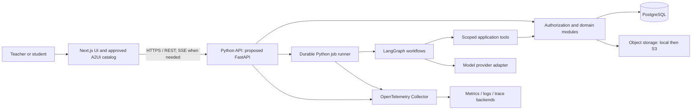

# Architecture proposal — not accepted implementation

## Initial shape

Start as a modular monolith, plus a worker only when durable jobs are needed. Domain modules: identity and institute membership, assignments/classes, evidence/progress, plans, conversations and agent orchestration. Python domain logic owns behavior; Next.js owns rendering and UI interactions. Use an API contract rather than reimplementing domain rules in TypeScript. Ordinary API routes are deterministic; AI interprets permitted evidence and proposes actions through those routes.

PostgreSQL is the proposed transactional source of truth. Suggested entities: Institute, User, Membership, Cohort, Enrollment, TeachingAssignment, LearningGoal, Evidence, ProgressSnapshot, PlanVersion, PlanApproval, Conversation, SharedSummary, AgentRun, AuditEvent. A user may have memberships in several institutes; the authenticated active institute and verified membership determine context. Scoped foreign keys should prevent cross-institute relationships. Workspace ownership does not imply a separate database. PostgreSQL row-level security is a possible defense in depth, after understanding policy execution and pooled connections; it does not replace application checks.

## Technology placement and promotion criteria

| Technology | Concrete role | Sequence and condition |
|---|---|---|
| HLD | Context, boundaries, data ownership, trust boundaries, capacity assumptions | Before application design; revisit when constraints change |
| LLD | Entities, invariants, API contracts, transactions and state machines | Per vertical slice after acceptance criteria |
| Next.js | Login shell, teacher/student routes, accessible conventional dashboards | First UI slice after the learning gate |
| A2UI | Approved plan cards, evidence panels and review forms composed by an agent | Early isolated compatibility spike; production after schema/action validation and fallback checks |
| Python / FastAPI | API, authorization and learning-domain services | Proposed backend; pin versions when implementation is authorized |
| LangGraph | Explicit evidence → draft → review → publish workflow with checkpoints | After deterministic evidence/plan modules; learn state and replay first |
| LangChain | Model/tool integrations when useful | Avoid adding an agent loop to every API operation |
| AWS | IAM, S3, compute, networking, backups and monitoring | Local first; costed short-lived cloud exercises; hosting choice pending estimate |
| Terraform | Reproducible AWS environments, state and change plans | After IAM/networking lesson; never put credentials/state into Git |
| OpenTelemetry | Instrumentation and trace/context propagation across API, jobs and tools | First executable slice; exclude raw private content by default |
| Prometheus | Request/job metrics, duration histograms and alert inputs | Local observability lab; avoid user IDs or prompts as metric labels |
| Loki | Searchable structured application logs with trace IDs | Local lab; access control and retention required for hosted use |
| Grafana | Dashboards that correlate metrics, logs and traces | Local lab; a trace backend such as Tempo or Jaeger is also required |
| Redis | Ephemeral cache, rate limits, later live fan-out | Introduce with a measured cache/rate-limit need; test outage and stale data; no authoritative progress state |
| Kafka | Durable evidence events for independent replayable consumers | Lab after outbox/delivery-semantics lesson; production only when replay, retention and consumer independence justify it |
| gRPC | Typed service-to-service calls, e.g. a genuinely extracted recommendation service | Lab with Python clients/servers, deadlines and cancellation; not required between modules or browser and API |
| WebSockets | Bidirectional live classroom/common board and presence | Later collaboration slice; SSE is simpler for one-way assistant output |
| Neo4j | Curriculum prerequisite graph and multi-hop learning-path queries | Lab on synthetic curriculum; benchmark against relational queries before adoption |
| Kubernetes | Scheduling, probes, rollout, resources, secrets and failure recovery | Local kind/k3d lab after containers; EKS only with revised budget and operational need |
| MCP | Expose authorized domain capabilities to an assistant, e.g. read evidence or draft plan | After scoped direct tools work; protocol is not permission enforcement |
| A2A | Interoperability between independently deployed Guru/Kshatra services | Later protocol lab; local LangGraph nodes suffice for initial coordination |

All technologies remain learning goals even when they do not enter the initial production deployment. A lab promotion needs an ADR with benefit, measured evidence, running cost, failure behavior and a simpler alternative.

## Python agent design

Suggested LangGraph state references institute, principal, learner, evidence IDs, plan version, run ID and review status. Resolve identity in trusted server code; model output must never select the authoritative tenant or grant. An opaque conversation/thread ID is a lookup key, not an access token. Scope checkpoints and stores by institute, principal and conversation; check access on load, stream, resume and history operations.

Flow: authorize → load allowed evidence → derive deterministic progress → draft with evidence references → validate structure and claims → pause for teacher review → reauthorize and verify expected version → publish transactionally → audit. Insufficient evidence returns a bounded request for more evidence. Draft generation has a token/time/call budget, cancellation and a maximum number of tool calls. Do not run Guru and Kshatra in an unbounded conversation loop.

Checkpoint recovery can repeat work. A stable command ID and unique database constraint must deduplicate publishing; resumption rechecks assignment revocation and stale approval. Human review intent is bound to an exact plan version. Prompt injection in retrieved material must not grant capabilities. Test adversarial inputs and fabricated citations. Use fake providers for deterministic tests, then a small, cost-capped evaluation set of permitted fixtures before accepting a real provider.

## Frontend boundary

Next.js remains TypeScript/React even though all backend/agent behavior is Python. A2UI supplies dynamic, constrained surfaces; it does not replace routing, identity, accessibility or server authorization. Verify the chosen React renderer and protocol version against Next.js client/server boundaries in a small spike. Register an allowlist of components and action schemas; never execute arbitrary agent-supplied HTML/JavaScript. An action is a request to the API and receives the same authorization, CSRF/session protections and validation as a conventional form. Provide a normal plan card when rendering fails and handle partial streams/disconnects.

## Events and real-time failure semantics

Keep evidence writes and an outbox record in one database transaction when asynchronous side effects are introduced. Consumers deduplicate by event ID and aggregate/version. Ordering is per relevant aggregate, not global. Do not claim Kafka transactions make database side effects exactly once. Test crash before/after acknowledgment, poison messages, replay, schema upgrades and stale projections. Broker choice remains open; simple durable jobs or an AWS queue may suffice.

Authorize each stream and subscription by institute and resource. Revalidate or close streams when access is revoked, bound buffers, define reconnect/cursor semantics and avoid broadcasting private data. Redis Pub/Sub is not durable history.

## Observability

OTel instruments and exports; it is not a storage backend. Proposed local flow: application/worker → Collector → Prometheus-compatible metrics, Loki logs and Tempo/Jaeger traces → Grafana. A single request/job/run correlation chain should allow investigation without logging prompts, student answers or credentials. Track API availability/latency, model duration/errors, draft validation failures, queue age, tool denials and cost per run. Choose sampling and retention explicitly. Telemetry outages should not corrupt learning records.

## AWS under INR 2,000/month

Treat the ceiling as a design input, not a verified hosting estimate. Do not assume free-tier eligibility. Region, taxes, exchange rate, model provider, runtime hours and traffic are unconfirmed. Before any apply, calculate compute, disks, database, IPv4, backups, S3 requests/storage, logs, egress, load balancers, NAT and model charges. Budget notifications are alerts, not a spending stop.

Default development: local containers and synthetic data; run the observability stack and other labs only as needed. A possible low-cost AWS lab is one short-lived small VM plus tightly scoped S3. A single VM and local database are a learning deployment with availability limits. ECS/Fargate plus managed PostgreSQL is a later costed hosting candidate; EKS and managed Kafka are outside the default plan. No production SLA follows from this proposal. Demonstrate backup restore, restricted network access, TLS, least-privilege IAM and teardown before any pilot.

A credible live production environment may require a larger budget. Agree on service objectives and a cost estimate before choosing that tradeoff.

## Primary references (checked 2026-11-17)

- [LangGraph overview](https://docs.langchain.com/oss/python/langgraph/overview) and [persistence](https://docs.langchain.com/oss/python/langgraph/persistence): orchestration and state.
- [LangChain overview](https://docs.langchain.com/oss/python/langchain/overview): model/tool integration options.
- [A2UI](https://a2ui.org/): native component rendering; verify exact packages before the spike.
- [A2A and MCP](https://a2a-protocol.org/latest/topics/a2a-and-mcp/): independent-agent and tool boundaries.
- [gRPC introduction](https://grpc.io/docs/what-is-grpc/introduction/) and [Kafka introduction](https://kafka.apache.org/intro/).
- [OTel overview](https://opentelemetry.io/docs/what-is-opentelemetry/), [Prometheus overview](https://prometheus.io/docs/introduction/overview/), [Loki overview](https://grafana.com/docs/loki/latest/get-started/overview/).
- [ECS/Fargate](https://docs.aws.amazon.com/AmazonECS/latest/developerguide/AWS_Fargate.html) and [EKS](https://docs.aws.amazon.com/eks/latest/userguide/what-is-eks.html). These establish capabilities, not affordability.

Technology placement, sequence and budget guidance above are project-specific engineering proposals, not claims made by those sources.
